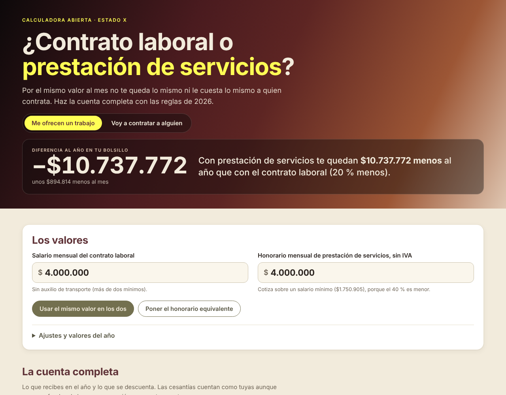

# ¿Contrato laboral o prestación de servicios?

**[Español](#español) · [English](#english)**

## Español

Calculadora abierta para saber **cuánto te queda al año y cuánto le cuesta a quien contrata** un contrato laboral frente a uno de prestación de servicios en Colombia, con las reglas de 2026.

**Ábrela aquí:** https://estado-x.github.io/calculadora-laboral-colombia/

### Qué hace

- **Dos miradas, con un botón:** «Me ofrecen un trabajo» (cuánto te queda en el bolsillo) y «Voy a contratar a alguien» (cuánto cuesta cada forma).
- **La cuenta completa:** prima, cesantías e intereses, vacaciones, aportes a salud y pensión, Fondo de Solidaridad Pensional, riesgos laborales (ARL), caja de compensación, ICBF y SENA, y retención en la fuente.
- **Equivalencias:** qué honorario deja lo mismo que un salario, qué salario equivale a un honorario y qué honorario cabe en lo que cuesta un contrato laboral.
- **Ajustes:** clase de riesgo laboral, retención en la fuente sí o no, exoneración del art. 114-1 del Estatuto Tributario, y los valores del año (salario mínimo, auxilio de transporte y UVT).
- **Enlace para compartir:** la dirección guarda la mirada y los dos valores (por ejemplo, `#mirada=persona&salario=4000000&honorario=4000000`).

### Cómo se calcula

| Regla | Valor | Fuente |
|---|---|---|
| Salario mínimo 2026 | $1.750.905 | Decreto 1469 de 2025 |
| Auxilio de transporte 2026 (salarios de hasta 2 mínimos) | $249.095 | Decreto 1470 de 2025 |
| UVT 2026 | $52.374 | Resolución DIAN 000238 de 2025 |
| Prima de servicios y cesantías | Un mes al año cada una, con el auxilio de transporte en la base | Código Sustantivo del Trabajo, arts. 249 y 306 |
| Intereses sobre cesantías | 12 % al año | Ley 52 de 1975 |
| Vacaciones | 15 días hábiles pagados al año | Código Sustantivo del Trabajo, art. 186 |
| Aportes del trabajador | Salud 4 % y pensión 4 % | Ley 100 de 1993 |
| Aportes del empleador | Pensión 12 %, ARL según riesgo, caja 4 %; salud 8,5 %, ICBF 3 % y SENA 2 % si no está exonerado. Caja, ICBF y SENA sobre el salario completo, sin el tope de 25 mínimos | Ley 100 de 1993; Ley 21 de 1982; Estatuto Tributario, art. 114-1 |
| Base de cotización del contratista | 40 % del honorario sin IVA, entre 1 y 25 salarios mínimos, sin restar costos | Ley 2277 de 2022, art. 89; [guía de la UGPP](https://www.ugpp.gov.co/wp-content/uploads/2026/01/ABC-Trabajador-Independiente-Contrato-Prestacion-Servicios.pdf) |
| Aportes del contratista | Salud 12,5 %, pensión 16 % y ARL (riesgos I a III; en IV y V la paga quien contrata) | Ley 100 de 1993; Decreto 723 de 2013 |
| Fondo de Solidaridad Pensional | 1 % desde 4 mínimos, sube por tramos desde 16 y llega a 2 % con más de 20 | Ley 797 de 2003; Decreto 510 de 2003 |
| Retención en la fuente | Ingreso del mes menos aportes obligatorios y renta exenta del 25 % (hasta 790 UVT al año), en la tabla del art. 383 | Estatuto Tributario, arts. 206 y 383 |

En el contrato laboral, la retención se calcula sobre los doce salarios y los dos pagos de la prima. El dinero que «te queda» incluye las cesantías, aunque van a un fondo; el ahorro para pensión se muestra aparte.

### Cómo funciona

- Es una página estática (HTML, CSS y JavaScript) publicada con GitHub Pages. No tiene servidor ni base de datos, no necesita claves y **no envía a ningún lado** los valores que escribes.
- Todo el cálculo vive en `assets/calculo.js`, separado de la interfaz (`assets/app.js`). Las pruebas están en `pruebas/` e incluyen el ejemplo de la guía de la UGPP.

### Úsala o adáptala

1. Haz un fork de este repositorio.
2. Activa GitHub Pages (Settings → Pages → rama `main`, carpeta raíz).
3. Para probarla en tu computador: `python -m http.server` y abre `http://localhost:8000`. Para correr las pruebas: `node --test pruebas/calculo.test.js` (Node 18 o superior, sin instalar nada).

**Cada enero** cambian el salario mínimo, el auxilio de transporte y la UVT: actualiza `PARAMETROS_2026` en `assets/calculo.js` (y su nombre) y corre las pruebas. Mientras tanto, cualquiera puede escribir los valores nuevos en «Ajustes y valores del año».

### Límites

- Es una guía para comparar, **no una liquidación oficial** ni asesoría legal o tributaria.
- El decreto del salario mínimo 2026 tiene demandas de nulidad pendientes en el Consejo de Estado. Si cambia, el valor se puede ajustar en la página.
- La retención en la fuente es un anticipo del impuesto de renta, no el impuesto final. No incluye otras deducciones (dependientes, intereses de vivienda, medicina prepagada) ni el tope del 40 % con otras rentas exentas.
- Las cesantías y sus intereses se tratan como exentos. Para salarios promedio de más de 350 UVT, la ley solo exime una parte.
- No incluye salario integral, horas extra, recargos, dotación, indemnizaciones, IVA ni ICA del contratista, ni aportes voluntarios.
- Compara costos y no dice qué figura corresponde. Si hay subordinación, horario y continuidad, la ley trata la relación como un contrato laboral.
- Las equivalencias son aproximadas en los saltos que trae la ley: al pasar de dos mínimos se pierde el auxilio de transporte, desde cuatro entra el Fondo de Solidaridad Pensional y la tabla de retención tiene escalones.
- La reforma pensional (Ley 2381 de 2024) empieza a regir el 1 de abril de 2027, según la Sentencia C-264 de 2026 de la Corte Constitucional, y cambiará parte de estas reglas.

### Crédito

Inspirada en **[worth-calculator](https://github.com/Zippland/worth-calculator)** de Zylan (licencia MIT) y su idea de calcular cuánto vale de verdad un trabajo más allá del salario. Esta es una versión nueva, escrita desde cero para las reglas de Colombia. No reutiliza código de worth-calculator.

Las normas y valores son de sus autores: Congreso de la República, Gobierno nacional, DIAN y UGPP.

Hecho por **[Estado X](https://estadox.com)** · Código con licencia MIT.

---

## English

An open calculator that shows **how much you keep each year, and how much it costs the employer**, under a Colombian employment contract compared with an independent services contract (*prestación de servicios*), using the 2026 rules.

**Open it here:** https://estado-x.github.io/calculadora-laboral-colombia/

### What it does

- **Two views, one switch:** "I got a job offer" (what you keep) and "I'm hiring someone" (what each option costs).
- **The full math:** service bonus (*prima*), severance (*cesantías*) and its interest, paid vacation, health and pension contributions, the Pension Solidarity Fund, occupational risk insurance (ARL), family compensation fund, ICBF and SENA, and income tax withholding.
- **Equivalents:** the fee that leaves you the same as a salary, the salary that matches a fee, and the fee you could pay for what an employment contract costs.
- **Settings:** risk class, withholding on or off, the Tax Code art. 114-1 exemption, and the year's values (minimum wage, transport allowance and UVT tax unit).
- **Shareable link:** the URL keeps the view and both amounts.

### How it is calculated

The rules, values and legal sources are listed in the Spanish table above. In short: 2026 minimum wage COP 1,750,905 and transport allowance COP 249,095 (Decrees 1469 and 1470 of 2025); UVT COP 52,374 (DIAN Resolution 000238 of 2025); contractors contribute on 40% of their fee (Law 2277 of 2022, art. 89), with no cost deductions; withholding follows the art. 383 table after subtracting mandatory contributions and the 25% exempt income (capped at 790 UVT a year).

### How it works

- A static page (HTML, CSS and JavaScript) published with GitHub Pages. No server, no database, no keys, and **nothing you type is sent anywhere**.
- The math lives in `assets/calculo.js`, apart from the interface (`assets/app.js`). Tests are in `pruebas/` and include the worked example from the UGPP guide.

### Use it or adapt it

1. Fork this repository.
2. Turn on GitHub Pages (Settings → Pages → `main` branch, root folder).
3. To try it locally: `python -m http.server` and open `http://localhost:8000`. To run the tests: `node --test pruebas/calculo.test.js` (Node 18+, nothing to install).

**Every January** the minimum wage, transport allowance and UVT change: update `PARAMETROS_2026` in `assets/calculo.js` and run the tests. Meanwhile, anyone can type the new values under "Ajustes y valores del año".

### Limits

- It is a comparison guide, **not an official payroll calculation** nor legal or tax advice.
- The 2026 minimum wage decree faces pending annulment claims before the Council of State. The value can be changed on the page.
- Withholding is an advance on income tax, not the final tax. Other deductions and the 40% cap with other exempt income are not included.
- Severance and its interest are treated as exempt; above an average salary of 350 UVT, the law only exempts part of it.
- Integral salary, overtime, surcharges, work clothing, severance pay for dismissal, the contractor's VAT or ICA, and voluntary contributions are not included.
- It compares costs; it does not say which contract applies. If there is subordination, a schedule and continuity, the law treats the relationship as employment.
- Equivalents are approximate around the law's steps: the transport allowance ends above two minimum wages, the Solidarity Fund starts at four, and the withholding table has jumps.
- The pension reform (Law 2381 of 2024) takes effect on April 1, 2027, per Constitutional Court ruling C-264 of 2026, and will change some of these rules.

### Credit

Inspired by **[worth-calculator](https://github.com/Zippland/worth-calculator)** by Zylan (MIT license) and its idea of measuring what a job is really worth beyond the salary. This is a new version, written from scratch for Colombian rules. It does not reuse worth-calculator code.

Laws and values belong to their publishers: the Colombian Congress and Government, DIAN and UGPP.

Made by **[Estado X](https://estadox.com)** · Code under the MIT license.
